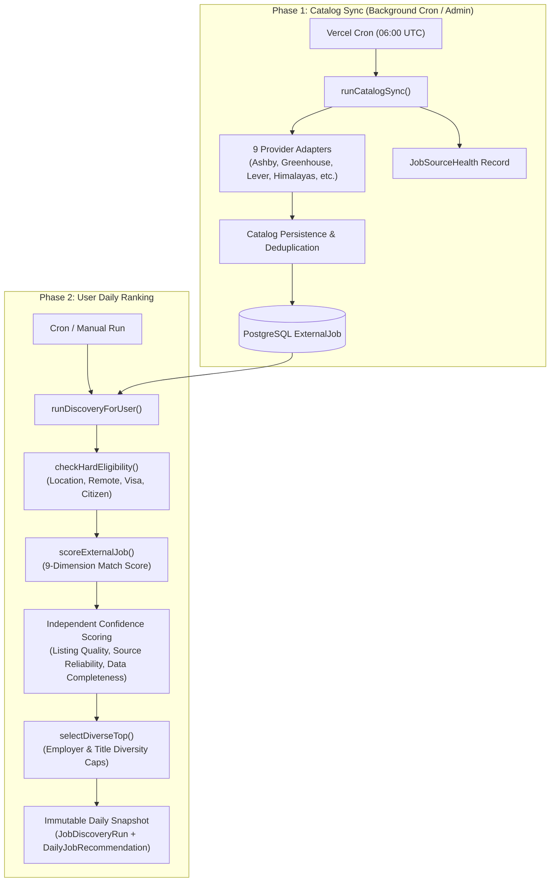

# Intelligent Daily Job Discovery

## Overview

teChia Jobs discovers, normalizes, ranks, and persists a daily shortlist of up to five high-relevance job opportunities for eligible Pro/Premium users.

Five is a ceiling, not a padded promise: the system will never pad a shortlist with stale, unrelated, or ineligible listings when available inventory does not meet our quality bar.

The job discovery architecture operates in two decoupled phases:
1. **Shared Multi-Source Catalog Ingestion (`runCatalogSync`)**: Continuously ingests and refreshes verified job opportunities from primary applicant tracking systems (ATS) and compliant public job feeds into a global PostgreSQL index (`ExternalJob`).
2. **Personalized Daily Candidate Ranking (`runDiscoveryForUser`)**: Evaluates eligible catalog jobs against user career profile preferences, applies strict hard-eligibility gating, computes multi-factor fit and confidence scores, and produces an immutable, timezone-stable daily recommendation snapshot.

---

## Catalog Sources & Compliance

The catalog ingests exclusively from primary ATS endpoints, official government portals, and compliant public APIs.

### Free Primary ATS Sources (No API keys required)
- **Ashby public job boards** (`ashby.ts`): Public requisition endpoints for leading technology companies.
- **Greenhouse public job boards** (`greenhouse.ts`): Public job board API (`/v1/boards/{token}/jobs`). High-volume boards automatically utilize metadata description mode to prevent timeout.
- **Lever public job sites** (`lever.ts`): Public postings API (`/v1/postings/{site}`).

*Seeded Boards*: 80 verified employer boards are pre-configured in `src/lib/job-discovery/catalog/employer-boards.ts` covering top companies such as Anthropic, Stripe, Figma, OpenAI, Vercel, Linear, Supabase, Cloudflare, Retool, Ramp, Brex, and more.

### Free Public Aggregator Feeds (No API keys required)
- **Himalayas API** (`himalayas.ts`): Remote job listings. Free tier uses cursor pagination (max 20/page).
  - *Compliance & Attribution*: Direct application URLs are preserved without redirection. Job listings include visible Himalayas attribution links. Per Himalayas terms, listings are not redistributed through `JobPosting` schema markup.
- **Arbeitnow API** (`arbeitnow.ts`): Free European and global remote tech job feed.
- **Remote OK API** (`remoteok.ts`): Free remote tech postings. Automatically ignores legal/sponsor header records.
- **4dayweek free feed** (`fourdayweek.ts`): Curated 4-day workweek jobs. Ingestion begins at page 24+ (`FOURDAYWEEK_START_PAGE=24`) to read unlocked public listings and skips locked premium posts.

### Credentialed & Government Sources
- **USAJOBS API** (`usajobs.ts`): Official United States Federal Government employment search API.
  - *Requirements*: `USAJOBS_API_KEY` and `USAJOBS_USER_AGENT` (contact email).
  - *Behavior*: Fails closed and remains disabled when unconfigured.
- **Headcount Labs API** (`headcountlabs.ts`): Licensed developer job postings API.
  - *Requirements*: `HEADCOUNTLABS_API_KEY` and explicit license confirmation `HEADCOUNTLABS_LICENSE_ACK=true`.
  - *Quotas*: Enforces rate limits (30 req/min, 1,000 req/day, 100,000 records/mo) and tracks `X-Data-Records-*` headers.
  - *Attribution*: All imported listings carry required "Data provided by Headcount Labs" attribution metadata.
  - *Behavior*: Fails closed and remains disabled when unconfigured.

---

## Two-Phase Architecture

### 1. Ingestion Correctness & Board Closure Safety
- Providers fetch job listings with pagination and budget tracking.
- If a provider run is truncated due to time budget or page limits, the adapter explicitly flags `complete: false`.
- **Closure Safety (`closeMissingFromBoard`)**: Missing board jobs are marked as closed in `ExternalJob` **only** if the adapter achieved a complete board crawl (`complete === true`). Partial syncs never falsely close valid opportunities.

### 2. Hard Eligibility Filtering (`eligibility.ts`)
Before computing relevance, candidates undergo strict deterministic gating:
- **Status & Freshness**: Requisition must be open, unexpired, and verified within 21 days.
- **Workplace Model**: If user preferences are strictly remote (`WORKPLACE_TYPE_REMOTE`), explicit on-site roles are rejected.
- **Geographic Restrictions**: Validates candidate target countries (`workCountries`) against job `countryCodes` and `locationRestrictions`.
- **Visa Sponsorship**: If the user requires visa sponsorship (`requiresVisaSponsorship: true`), listings that explicitly state sponsorship is not offered are excluded.
- **Citizenship & Clearances**: Roles requiring specific citizenship or security clearances (e.g., US Federal roles) are gated according to user eligibility.

### 3. Multi-Factor Scoring & Confidence Metrics (`scoring.ts`, `confidence.ts`)
Scoring separates user fit from data quality and source reliability:
- **Match Score (0–100)**: Evaluates 9 dimensions: target titles & role synonyms, seniority tier, required & preferred tech stack skills, workplace & timezone overlap, domain/industry alignment, employment type, and compensation bounds.
- **Listing Quality (0–100)**: Measures the richness of the job posting (structured responsibilities, qualification clarity, compensation transparency).
- **Source Confidence (0–100)**: Direct employer ATS (95), official government API (90), verified syndicators (75), web aggregators (70).
- **Data Completeness (0–100)**: Verifies presence of essential fields (company, title, description, application link, location, publication date).
- **Composite Ranking Score**: Combines match score with quality and reliability weights to prevent poorly-described or low-trust listings from outranking verified primary listings.

### 4. Timezone-Aware Daily Snapshots
- Discovery runs are keyed to each user's local calendar day using their IANA timezone (`UserProfile.timezone`, e.g., `America/New_York`, `Europe/Berlin`, `UTC`).
- **Snapshot Stability**: Once recommendations are generated for a given local date, the run is stored as `COMPLETED`. Subsequent page visits or manual refreshes on the same calendar day reuse the existing snapshot (`reused: true`), ensuring a stable, non-shifting shortlist for the user.

---

## Scheduling & Deployment Boundaries

### Daily Vercel Cron
- **Route**: `GET /api/cron/job-discovery`
- **Schedule**: `0 6 * * *` (06:00 UTC daily in `vercel.json`)
- **Security**: Secured via `CRON_SECRET` authorization header; requests without valid credentials fail closed.
- **Execution Budget**:
  - Allocates up to 50 seconds for `runCatalogSync` to ingest external sources within serverless timeout limits.
  - Next, processes active Pro/Premium users whose local calendar day needs a fresh snapshot.

### Admin Operations & Observability
- **Dashboard**: `/admin/system` displays real-time health status, success rates, listing counts, and recent sync runs for all 9 providers.
- **API**: `GET /api/admin/job-sources` (health summary) and `POST /api/admin/job-sources` (trigger on-demand catalog sync or toggle provider availability).

---

## Environment Variables Reference

| Variable | Required | Default | Description |
| :--- | :--- | :--- | :--- |
| `CRON_SECRET` | Yes (for cron) | — | Bearer secret authorizing Vercel cron calls |
| `ASHBY_ENABLED` | No | `true` | Enable/disable Ashby ATS ingestion |
| `GREENHOUSE_ENABLED` | No | `true` | Enable/disable Greenhouse ATS ingestion |
| `LEVER_ENABLED` | No | `true` | Enable/disable Lever ATS ingestion |
| `HIMALAYAS_ENABLED` | No | `true` | Enable/disable Himalayas feed ingestion |
| `HIMALAYAS_API_KEY` | No | `""` | Optional Himalayas API key (expands rate limits) |
| `ARBEITNOW_ENABLED` | No | `true` | Enable/disable Arbeitnow feed ingestion |
| `REMOTEOK_ENABLED` | No | `true` | Enable/disable Remote OK feed ingestion |
| `FOURDAYWEEK_ENABLED` | No | `true` | Enable/disable 4dayweek feed ingestion |
| `FOURDAYWEEK_START_PAGE` | No | `24` | Starting page for 4dayweek public feed |
| `USAJOBS_ENABLED` | No | `true` | Enable/disable USAJOBS provider |
| `USAJOBS_API_KEY` | No | `""` | Required for USAJOBS; fails closed if empty |
| `USAJOBS_USER_AGENT` | No | `""` | Contact email header required by USAJOBS API |
| `HEADCOUNTLABS_ENABLED`| No | `false` | Enable/disable Headcount Labs provider |
| `HEADCOUNTLABS_API_KEY`| No | `""` | Required for Headcount Labs; fails closed if empty |
| `HEADCOUNTLABS_LICENSE_ACK` | No | `false` | Must be `true` to confirm compliance with Headcount terms |
| `CATALOG_SYNC_MAX_DURATION_MS` | No | `50000` | Execution time budget for cron catalog sync (ms) |
