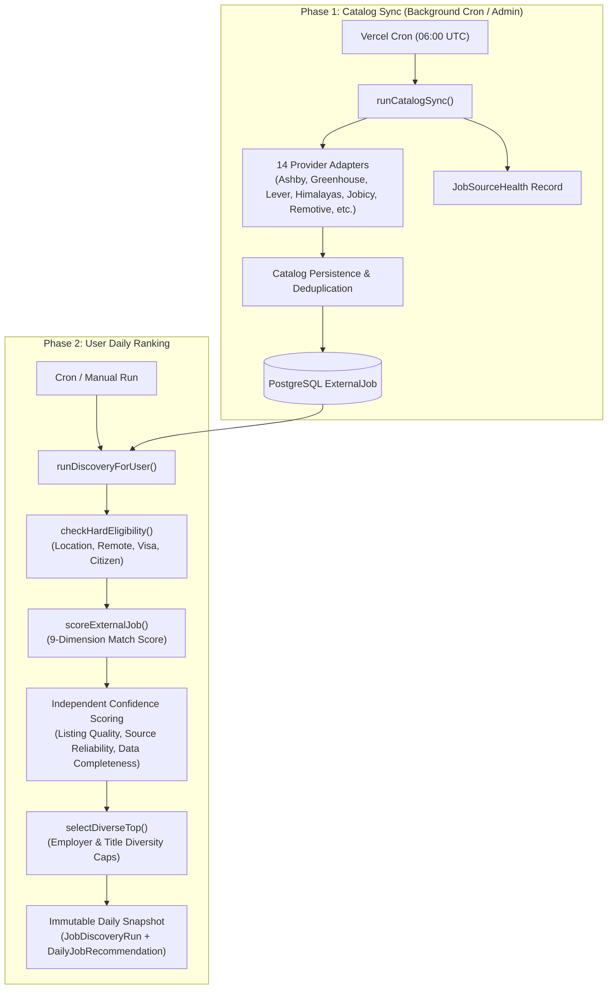

# Intelligent Daily Job Discovery

## Overview

teChia Jobs discovers, normalizes, ranks, and persists a daily shortlist of up to five high-relevance job opportunities for eligible Pro/Premium users.

Five is a ceiling, not a padded promise: the system will never pad a shortlist with stale, unrelated, or ineligible listings when available inventory does not meet our quality bar.

The job discovery architecture operates in two decoupled phases:
1. **Shared Multi-Source Catalog Ingestion (`runCatalogSync`)**: Continuously ingests and refreshes verified job opportunities from primary applicant tracking systems (ATS) and compliant public job feeds into a global PostgreSQL index (`ExternalJob`).
2. **Personalized Daily Candidate Ranking (`runDiscoveryForUser`)**: Evaluates eligible catalog jobs against user career profile preferences, applies strict hard-eligibility gating, computes multi-factor fit and confidence scores, and produces an immutable, timezone-stable daily recommendation snapshot.

---

## Catalog Sources & Compliance

The catalog ingests exclusively from primary ATS endpoints, official government portals, and compliant public APIs.

### Free Primary ATS Sources (No API keys required)
- **Ashby public job boards** (`ashby.ts`): Public requisition endpoints for leading technology companies.
- **Greenhouse public job boards** (`greenhouse.ts`): Public job board API (`/v1/boards/{token}/jobs`). High-volume boards automatically utilize metadata description mode to prevent timeout.
- **Lever public job sites** (`lever.ts`): Public postings API (`/v1/postings/{site}`).

*Seeded Boards*: 80 verified employer boards are pre-configured in `src/lib/job-discovery/catalog/employer-boards.ts` covering top companies such as Anthropic, Stripe, Figma, OpenAI, Vercel, Linear, Supabase, Cloudflare, Retool, Ramp, Brex, and more.

### Free Public Aggregator Feeds (No API keys required)
- **Himalayas API** (`himalayas.ts`): Remote job listings. Free tier uses cursor pagination (max 20/page).
  - *Compliance & Attribution*: Direct application URLs are preserved without redirection. Job listings include visible Himalayas attribution links. Per Himalayas terms, listings are not redistributed through `JobPosting` schema markup.
- **Arbeitnow API** (`arbeitnow.ts`): Free European and global remote tech job feed.
- **Remote OK API** (`remoteok.ts`): Free remote tech postings. Automatically ignores legal/sponsor header records.
- **4dayweek free feed** (`fourdayweek.ts`): Curated 4-day workweek jobs. Ingestion begins at page 24+ (`FOURDAYWEEK_START_PAGE=24`) to read unlocked public listings and skips locked premium posts.
- **Jobicy API** (`jobicy.ts`): Free remote job feed with opaque cursor pagination (100 records/page, capped at three pages per run).
  - *Compliance & Attribution*: Jobicy must be visibly credited and links must point to the supplied listing URL. The free feed intentionally returns Jobicy listing URLs rather than direct employer ATS URLs, so the listing page is both the canonical and application URL. Direct ATS URLs require Jobicy's commercial API.
  - *Structured data*: Disabled, consistent with the other aggregator feeds.
- **Remotive API** (`remotive.ts`): Free remote job API. Listings link to the supplied Remotive URL and visibly credit Remotive.
- **Working Nomads API** (`workingnomads.ts`): Free remote job API for distributed roles.
- **We Work Remotely RSS** (`weworkremotely.ts`): Public RSS categories (programming, design, product and customer support). Items are attributed to WWR and link to the supplied feed URL.
- **Jobspresso RSS** (`jobspresso.ts`): Free remote-work job feed. The employer and location are read from the feed creator field when present.

### English-Only Listing Policy

The product is English-only. Listings that are clearly written in another language are not recommended and are not persisted into the shared catalogue.

- `language.ts` scores title + description against distinctive function-word profiles for German, French, Spanish, Portuguese, Dutch, Italian and Polish, with diacritic evidence as a secondary signal.
- Detection is conservative: it returns `non-en` only with substantial evidence. Short or missing descriptions return `unknown` and are allowed through, because incomplete data is not proof of a non-English posting.
- The gate runs twice: at catalog persistence (`persistSourceJobs`) so new non-English rows never accumulate, and in `checkHardEligibility` so legacy rows are still excluded from recommendations.
- Sync metrics report `languageFiltered` at the run, provider and note level. No schema change is required.

### Credentialed & Government Sources
- **USAJOBS API** (`usajobs.ts`): Official United States Federal Government employment search API.
  - *Requirements*: `USAJOBS_API_KEY` and `USAJOBS_USER_AGENT` (contact email).
  - *Behavior*: Fails closed and remains disabled when unconfigured.
- **Headcount Labs API** (`headcountlabs.ts`): Licensed developer job postings API.
  - *Requirements*: `HEADCOUNTLABS_API_KEY` and explicit license confirmation `HEADCOUNTLABS_LICENSE_ACK=true`.
  - *Quotas*: Enforces rate limits (30 req/min, 1,000 req/day, 100,000 records/mo) and tracks `X-Data-Records-*` headers.
  - *Attribution*: All imported listings carry required "Data provided by Headcount Labs" attribution metadata.
  - *Behavior*: Fails closed and remains disabled when unconfigured.

---

## Two-Phase Architecture

### 1. Ingestion Correctness & Board Closure Safety
- Providers fetch job listings with pagination and budget tracking.
- Feed sources and board sources are scheduled in one bounded pool (concurrency 3), so many small feeds run alongside slower board crawls instead of behind them.
- If a provider run is truncated due to time budget or page limits, the adapter explicitly flags `complete: false`.
- **Closure Safety (`closeMissingFromBoard`)**: Missing board jobs are marked as closed in `ExternalJob` **only** if the adapter achieved a complete board crawl (`complete === true`). Partial syncs never falsely close valid opportunities.
- **Link Repair**: Persistence always stores `applicationUrl`, `canonicalUrl` and `employerUrl`. When a stored row matches by fingerprint but is missing a link the provider now supplies, the row is updated on the next sync. This repairs catalogue rows written before URL persistence was added.
- **Language Filter**: Non-English listings are discarded before deduplication/persistence and counted in sync metrics.

### Public jobs page

The public jobs page (`/jobs-public`) and the in-app public browser draw from two inventories in one SQL view: roles added by the community (`JobLead`, excluding notes and other private fields) and the automatically fetched catalog (`ExternalJob`). Results are deduplicated on trimmed company + title, support category/source/seniority/remote/employment/salary filters and sorting, and expose facet counts. Saving a public listing clones only the public fields into the user’s workspace; it never copies private notes or intelligence.

### 2. Hard Eligibility Filtering (`eligibility.ts`)
Before computing relevance, candidates undergo strict deterministic gating:
- **Status & Freshness**: Requisition must be open, unexpired, published within 60 days (or have no publication date), and verified within 21 days. The older 30-day hard cutoff was removed; the 60-day window and fit floor remain.
- **Language**: Clearly non-English postings are rejected (English-only product policy).
- **Workplace Model**: If user preferences are strictly remote (`WORKPLACE_TYPE_REMOTE`), explicit on-site roles are rejected.
- **Geographic Restrictions**: Validates candidate target countries (`workCountries`) against job `countryCodes` and `locationRestrictions`.
- **Visa Sponsorship**: If the user requires visa sponsorship (`requiresVisaSponsorship: true`), listings that explicitly state sponsorship is not offered are excluded.
- **Citizenship & Clearances**: Roles requiring specific citizenship or security clearances (e.g., US Federal roles) are gated according to user eligibility.

### 3. Candidate Recall

Discovery does not load the whole catalogue for every user, and it does not rely on the newest 1,000 rows:

- `buildCandidateTitleTerms` derives phrases and tokens from target roles, preferred titles and preferred stack.
- The primary query fetches up to 2,000 recent listings whose titles match those terms (case-insensitive), so relevant roles older than the previous 30-day cutoff are still considered.
- A 400-row recent fallback catches relevant roles with unusual titles.
- The pool remains bounded per user, which protects the cron's serverless time budget as the catalogue grows.
- `fitScore >= 30` remains the quality floor; the shortlist is never padded.

### 4. Multi-Factor Scoring & Confidence Metrics (`scoring.ts`, `confidence.ts`)
Scoring separates user fit from data quality and source reliability:
- **Match Score (0–100)**: Evaluates 9 dimensions: target titles & role synonyms, seniority tier, required & preferred tech stack skills, workplace & timezone overlap, domain/industry alignment, employment type, and compensation bounds.
- **Listing Quality (0–100)**: Measures the richness of the job posting (structured responsibilities, qualification clarity, compensation transparency).
- **Source Confidence (0–100)**: Direct employer ATS (95), official government API (90), verified syndicators (75), web aggregators (70).
- **Data Completeness (0–100)**: Verifies presence of essential fields (company, title, description, application link, location, publication date).
- **Composite Ranking Score**: Combines match score with quality and reliability weights to prevent poorly-described or low-trust listings from outranking verified primary listings.

### 5. Timezone-Aware Daily Snapshots
- Discovery runs are keyed to each user's local calendar day using their IANA timezone (`UserProfile.timezone`, e.g., `America/New_York`, `Europe/Berlin`, `UTC`).
- **Snapshot Stability**: Once recommendations are generated for a given local date, the run is stored as `COMPLETED`. Subsequent page visits or manual refreshes on the same calendar day reuse the existing snapshot (`reused: true`), ensuring a stable, non-shifting shortlist for the user.

---

## Scheduling & Deployment Boundaries

### Daily Vercel Cron
- **Route**: `GET /api/cron/job-discovery`
- **Schedule**: `0 6 * * *` (06:00 UTC daily in `vercel.json`)
- **Security**: Secured via `CRON_SECRET` authorization header; requests without valid credentials fail closed.
- **Execution Budget**:
  - Allocates up to 50 seconds for `runCatalogSync` to ingest external sources within serverless timeout limits.
  - Next, processes active Pro/Premium users whose local calendar day needs a fresh snapshot.

### Admin Operations & Observability
- **Dashboard**: `/admin/system` displays real-time health status, success rates, listing counts, and recent sync runs for all configured providers.
- **API**: `GET /api/admin/job-sources` (health summary) and `POST /api/admin/job-sources` (trigger on-demand catalog sync or toggle provider availability).

---

## Environment Variables Reference

| Variable | Required | Default | Description |
| :--- | :--- | :--- | :--- |
| `CRON_SECRET` | Yes (for cron) | — | Bearer secret authorizing Vercel cron calls |
| `ASHBY_ENABLED` | No | `true` | Enable/disable Ashby ATS ingestion |
| `GREENHOUSE_ENABLED` | No | `true` | Enable/disable Greenhouse ATS ingestion |
| `LEVER_ENABLED` | No | `true` | Enable/disable Lever ATS ingestion |
| `HIMALAYAS_ENABLED` | No | `true` | Enable/disable Himalayas feed ingestion |
| `HIMALAYAS_API_KEY` | No | `""` | Optional Himalayas API key (expands rate limits) |
| `ARBEITNOW_ENABLED` | No | `true` | Enable/disable Arbeitnow feed ingestion |
| `REMOTEOK_ENABLED` | No | `true` | Enable/disable Remote OK feed ingestion |
| `FOURDAYWEEK_ENABLED` | No | `true` | Enable/disable 4dayweek feed ingestion |
| `FOURDAYWEEK_START_PAGE` | No | `24` | Starting page for 4dayweek public feed |
| `JOBICY_ENABLED` | No | `true` | Enable/disable Jobicy feed ingestion |
| `REMOTIVE_ENABLED` | No | `true` | Enable/disable Remotive feed ingestion |
| `WORKINGNOMADS_ENABLED` | No | `true` | Enable/disable Working Nomads feed ingestion |
| `WEWORKREMOTELY_ENABLED` | No | `true` | Enable/disable We Work Remotely RSS ingestion |
| `JOBSPRESSO_ENABLED` | No | `true` | Enable/disable Jobspresso RSS ingestion |
| `USAJOBS_ENABLED` | No | `true` | Enable/disable USAJOBS provider |
| `USAJOBS_API_KEY` | No | `""` | Required for USAJOBS; fails closed if empty |
| `USAJOBS_USER_AGENT` | No | `""` | Contact email header required by USAJOBS API |
| `HEADCOUNTLABS_ENABLED`| No | `false` | Enable/disable Headcount Labs provider |
| `HEADCOUNTLABS_API_KEY`| No | `""` | Required for Headcount Labs; fails closed if empty |
| `HEADCOUNTLABS_LICENSE_ACK` | No | `false` | Must be `true` to confirm compliance with Headcount terms |
| `CATALOG_SYNC_MAX_DURATION_MS` | No | `50000` | Execution time budget for cron catalog sync (ms) |
